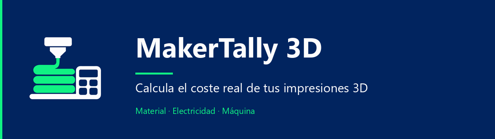
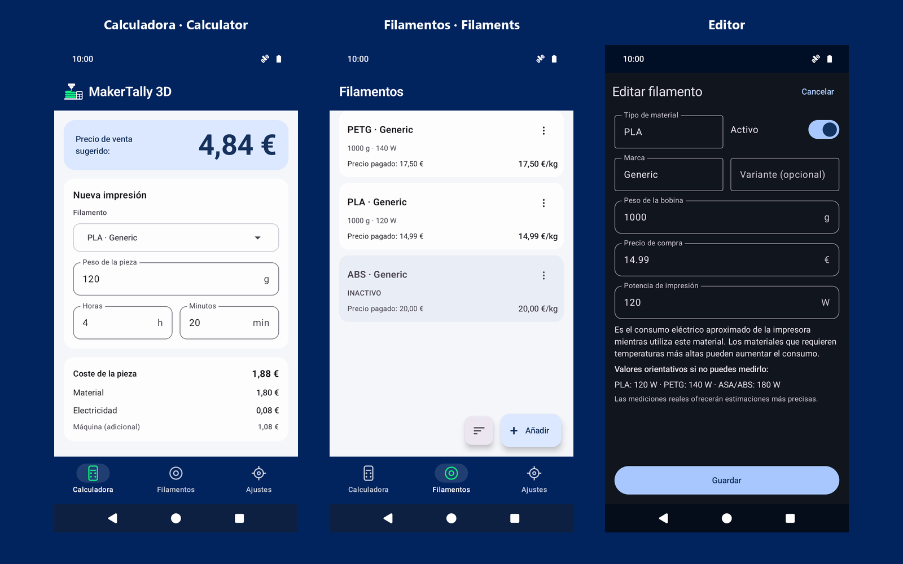
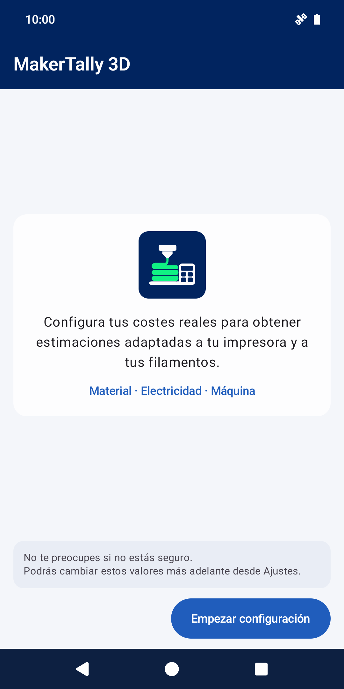
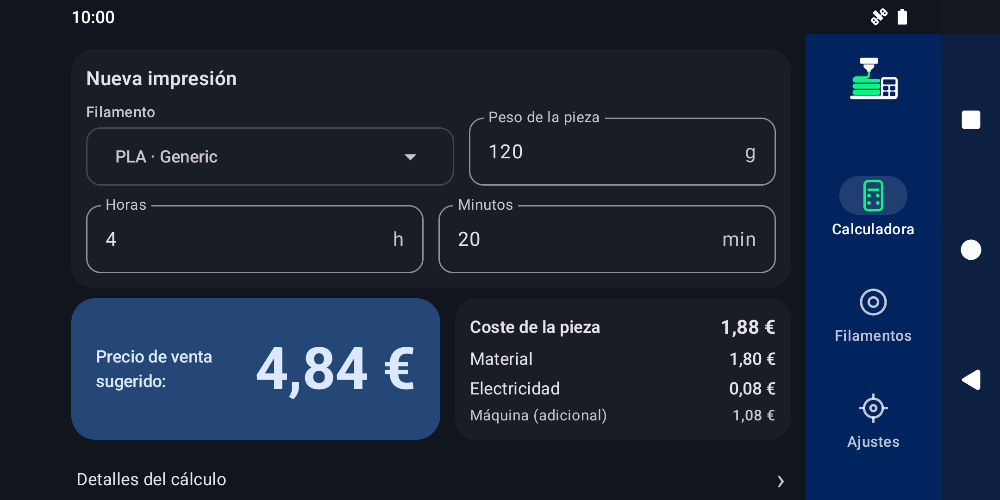

<strong>Español</strong> · <a href="README.en.md">English</a>

  
  
  
  
  

Estima el coste de tus impresiones 3D y un precio de venta orientativo con tus propios datos de material, electricidad y máquina.

<strong>Android · Offline · Sin cuentas · Sin anuncios · EUR (€)</strong>

  
   MakerTally 3D 1.1.0. Datos de ejemplo; interfaz disponible en español e inglés.

## Qué es MakerTally 3D

Una calculadora Android ligera para entender cuánto cuesta una pieza y orientar su precio de venta. Combina peso y precio del filamento, duración de la impresión, consumo eléctrico, calentamiento, impuestos efectivos, coste de máquina y un multiplicador configurable.

Los resultados dependen de los valores que introduzcas. La aplicación trabaja en **EUR (€)** y utiliza cálculos decimales exactos. No es un slicer, un ERP ni un gestor de pedidos o inventario: los perfiles de filamento **no representan stock restante**.

## Qué puedes hacer

| Área | Funciones |
| --- | --- |
| **Calculadora** | Elegir filamento, introducir peso y duración, consultar material, electricidad, coste de pieza, máquina y precio sugerido. Desplegar el detalle del cálculo y el margen bruto orientativo. |
| **Filamentos** | Crear, editar y eliminar perfiles con material, marca, variante, peso de bobina, precio y potencia aproximada. Activar/desactivar y ordenar por nombre o €/kg; los activos aparecen primero. |
| **Ajustes** | Configurar electricidad, impuestos efectivos, calentamiento, coste de máquina y multiplicador. Elegir Español/English y Sistema/Claro/Oscuro; consultar Ayuda y Privacidad sin conexión. |
| **Pantallas adaptativas** | Usar la app en portrait y landscape, con navegación lateral y composiciones de dos columnas cuando hay espacio. |

## Primer arranque en 1.1

La configuración guiada te permite introducir tus costes reales antes de calcular. Puedes cambiar estos valores después desde Ajustes.

Al terminar se añade un único perfil de ejemplo, **PLA · Generic**: bobina de **1000 g**, precio **14,99 €** y potencia de impresión **120 W**. Puedes editarlo, eliminarlo o añadir tus propios perfiles. Las referencias de consumo son orientativas y nunca rellenan campos automáticamente.

La calculadora comienza con Peso y Horas vacíos, Minutos en 0 y sin resultado inicial. Las instalaciones existentes de 1.0 se reconocen automáticamente: conservan sus ajustes, perfiles y preferencias, incluida una biblioteca vacía, sin repetir la configuración ni añadir Generic.

## Privacidad

MakerTally funciona **completamente offline**. No requiere cuenta y no tiene backend, nube propia, publicidad, analytics, tracking, telemetría ni informes remotos de fallos. No utiliza Google Play Services ni solicita el permiso **INTERNET**.

Los perfiles, ajustes, preferencias y el progreso de configuración se guardan localmente en el almacenamiento privado de la app. Los cálculos se realizan en el dispositivo. La política completa está disponible dentro de la aplicación, también sin red.

Consulta la [política en español](PRIVACY.es.md), el [documento canónico en inglés](PRIVACY.md) y los [avisos de terceros](THIRD_PARTY_NOTICES.md).

## Distribución

**Google Play es el único canal oficial de distribución de MakerTally 3D.** GitHub ofrece código fuente y documentación; no proporciona APK, AAB ni instaladores para descarga manual. No hay un botón de descarga mientras la ficha pública no esté disponible para todos los usuarios.

## Compatibilidad

- Android 7.0 o posterior (API 24+); compile/target SDK 36.
- Español e inglés; temas Sistema, Claro y Oscuro.
- Portrait y landscape adaptativo, con scroll para pantallas pequeñas y fuentes ampliadas.
- Moneda EUR; sin conversión ni selector de moneda.

La validación de desarrollo utiliza un emulador AOSP Android 16 / API 36. Esto no implica pruebas exhaustivas en todos los dispositivos; cada publicación requiere además una comprobación en hardware real.

Ver el layout landscape en modo oscuro

## Código y documentación

Construido con **Kotlin, Jetpack Compose y Material 3**. La suite actual contiene **90 tests JVM y 9 instrumentados**. Android CI valida el wrapper, tests JVM, lint y Debug; conserva únicamente informes de tests, nunca paquetes instalables. Los instrumentados se ejecutan localmente.

- [Historial de cambios](CHANGELOG.md)
- [Arquitectura](docs/ARCHITECTURE.es.md)
- [Cálculos y precisión](docs/CALCULATIONS.es.md)
- [Desarrollo y pruebas](docs/DEVELOPMENT.es.md)
- [Proceso de publicación](docs/RELEASE_PROCESS.es.md)
- [Contribuciones](CONTRIBUTING.md) · [Seguridad](SECURITY.md)

La etapa anterior .NET MAUI se conserva en el tag histórico `maui-alpha4-final`.

## Autor y soporte

Proyecto de **joseamc91**. Para errores y propuestas, utiliza [GitHub Issues](https://github.com/joseamc91/MakerTally3D/issues). Contacto público: **joseamc91.dev@gmail.com**. Las vulnerabilidades sensibles se comunican por privado según [SECURITY.md](SECURITY.md).

## Licencia

MakerTally 3D se distribuye bajo [Apache License 2.0](LICENSE). Consulta los [avisos de componentes de terceros](THIRD_PARTY_NOTICES.md).
